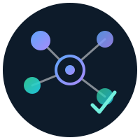

<p align="center">
  
</p>

<h1 align="center">le-harnais — distribution</h1>

<p align="center">
  <strong>Compiled binaries, models, datasets &amp; companion tools for the <em>le-harnais</em> local-model agent harness.</strong>
</p>

<p align="center">
  
  
  
  
  
</p>

> **⚠ Binary distribution.** This repo carries **compiled binaries** and pointers to
> Hugging-Face-hosted models — the source lives in the working repo. Large binaries are
> **split into ≤45 MB parts**; run [`join.sh`](join.sh) once after cloning to reassemble them.

---

## First: reassemble split binaries, then check your machine

```sh
./join.sh            # cat *.part-* → binaries, verify sha256, chmod +x  (only if parts exist)
./check-env.sh       # what's present/missing on this box (REQUIRED / LOGIC / TOOLS)
./install-ollama.sh  # install the generation backend if it's absent
```

## What's Inside

| Dir | Contents |
|---|---|
| [`bin/`](bin/) | the portable `lh` agent CLI (`linux-x86_64`, `linux-arm64`) + `lh-serve` (Linux+CUDA); macOS built on a Mac |
| [`tools/`](tools/) | companion **binaries** + skills: `aria` (quantum), `lift` (leanlift), `appsec` (security), `lean4-skills` |
| [`models/`](models/) | `MANIFEST.json` + `fetch_models.sh` — weights live in per-model Hugging Face repos |
| [`datasets/`](datasets/) | versioned, checksummed backup of the training/eval datasets |
| [`docs/`](docs/) | `CLI-TUTORIAL.md` (hands-on `lh` command tour) · `team-solve.md` (five-role recipe) · `models.md` · `REPRODUCE.md` · `PROVENANCE.md` |
| [`.claude/skills/team-solve/`](.claude/skills/team-solve/SKILL.md) | skill Goose and Claude Code load for the five-role recipe |
| **`check-env.sh` · `install-ollama.sh`** | environment doctor + generation-backend installer |
| **`BINARIES.md` · `DEPENDENCIES.md`** | per-target binary checklist + the full dependency map |

## Platforms

| target | `lh` | `lh-serve` | how |
|---|:-:|:-:|---|
| linux x86_64 | ✅ | ✅ CUDA | prebuilt here |
| linux arm64 (incl. DGX Spark) | ✅ | — (ollama) | prebuilt here |
| macOS arm64 | build on a Mac | Metal (on a Mac) | `./build-mac-all.sh` |

Generation is delegated to **ollama** (recommended) or any OpenAI-compatible endpoint;
`lh-serve` (candle) is the optional native server. `lh` itself is torch/CUDA-free.

## Five-role team

Start Goose or Claude Code in this directory and both load
[`.claude/skills/team-solve/SKILL.md`](.claude/skills/team-solve/SKILL.md).
Asked for the 5× recipe, that session runs `lh team-solve` and leaves the
implementation to that process. The worktree must already be a git checkout
with one commit. Set `LH_NUM_CTX=32768` for a GGUF that advertises a 262k
window. The prompt names the check in backticks (`` `bash check.sh` ``).
`--solo` is the one-context recipe.

```sh
export LH_NUM_CTX=32768
./bin/lh-linux-x86_64 team-solve --worktree "$DIR" --id run1 - <<'EOF'
Implement the task. Do not edit check.sh. The check command is `bash check.sh`.
EOF
```

Use `./bin/lh-linux-arm64` on arm64 Linux and `./bin/lh-macos-arm64` on a Mac.
The contract is [`docs/team-solve.md`](docs/team-solve.md). A runnable
interval-merge example is
[`examples/cookbook/09-team-solve`](examples/cookbook/09-team-solve).

## Verify integrity

Every binary is checksummed in `bin/SHA256SUMS`, `MANIFEST.json`, and each tool dir; split
binaries carry a `.sha256` that `join.sh` checks on reassembly. Binary arch labels are
guaranteed by `verify-arch.sh` (a filename like `*-linux-x86_64` always matches its real arch).
